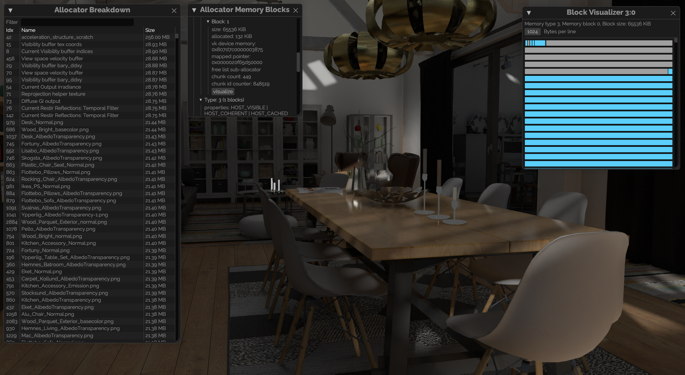

# 📒 gpu-allocator

[](https://github.com/Traverse-Research/gpu-allocator/actions)
[](https://crates.io/crates/gpu-allocator)
[](https://docs.rs/gpu-allocator/)
[](LICENSE-MIT)
[](LICENSE-APACHE)
[](../main/CODE_OF_CONDUCT.md)
[](https://blog.rust-lang.org/)

[](https://traverseresearch.nl)

```toml
[dependencies]
gpu-allocator = "0.28.0"
```



This crate provides a fully written in Rust memory allocator for Vulkan, DirectX 12 and Metal.

## Setting up the Vulkan memory allocator

```rust
use gpu_allocator::vulkan::*;

let mut allocator = Allocator::new(&AllocatorCreateDesc {
    instance,
    device,
    physical_device,
    debug_settings: Default::default(),
    buffer_device_address: true,  // Ideally, check the BufferDeviceAddressFeatures struct.
    allocation_sizes: Default::default(),
});
```

## Simple Vulkan allocation example

```rust
use gpu_allocator::vulkan::*;
use gpu_allocator::MemoryLocation;

// Setup vulkan info
let vk_info = vk::BufferCreateInfo::default()
    .size(512)
    .usage(vk::BufferUsageFlags::STORAGE_BUFFER);

let buffer = unsafe { device.create_buffer(&vk_info, None) }.unwrap();
let requirements = unsafe { device.get_buffer_memory_requirements(buffer) };

let allocation = allocator
    .allocate(&AllocationCreateDesc {
        name: "Example allocation",
        requirements,
        location: MemoryLocation::CpuToGpu,
        linear: true, // Buffers are always linear
        allocation_scheme: AllocationScheme::GpuAllocatorManaged,
    }).unwrap();

// Bind memory to the buffer
unsafe { device.bind_buffer_memory(buffer, allocation.memory(), allocation.offset()).unwrap() };

// Cleanup
allocator.free(allocation).unwrap();
unsafe { device.destroy_buffer(buffer, None) };
```

## Setting up the D3D12 memory allocator

```rust
use gpu_allocator::d3d12::*;

let mut allocator = Allocator::new(&AllocatorCreateDesc {
    device: ID3D12DeviceVersion::Device(device),
    debug_settings: Default::default(),
    allocation_sizes: Default::default(),
});
```

## Simple d3d12 allocation example

```rust
use gpu_allocator::d3d12::*;
use gpu_allocator::MemoryLocation;


let buffer_desc = d3d12_agility::D3D12_RESOURCE_DESC {
    Dimension: d3d12_agility::D3D12_RESOURCE_DIMENSION_BUFFER,
    Alignment: 0,
    Width: 512,
    Height: 1,
    DepthOrArraySize: 1,
    MipLevels: 1,
    Format: d3d12_agility::DXGI_FORMAT_UNKNOWN,
    SampleDesc: d3d12_agility::DXGI_SAMPLE_DESC {
        Count: 1,
        Quality: 0,
    },
    Layout: d3d12_agility::D3D12_TEXTURE_LAYOUT_ROW_MAJOR,
    Flags: d3d12_agility::D3D12_RESOURCE_FLAG_NONE,
};
let allocation_desc = AllocationCreateDesc::from_d3d12_resource_desc(
    &allocator.device(),
    &buffer_desc,
    "Example allocation",
    MemoryLocation::GpuOnly,
);
let allocation = allocator.allocate(&allocation_desc).unwrap();
let mut resource: Option<d3d12_agility::ID3D12Resource> = None;
let hr = unsafe {
    device.CreatePlacedResource(
        allocation.heap(),
        allocation.offset(),
        &buffer_desc,
        d3d12_agility::D3D12_RESOURCE_STATE_COMMON,
        None,
        &mut resource,
    )
}?;

// Cleanup
drop(resource);
allocator.free(allocation).unwrap();
```

## Setting up the Metal memory allocator

```rust
use gpu_allocator::metal::*;
let mut allocator = Allocator::new(&AllocatorCreateDesc {
    device: device.clone(),
    debug_settings: Default::default(),
    allocation_sizes: Default::default(),
    create_residency_set: false,
});
```

## Simple Metal allocation example

```rust
use gpu_allocator::metal::*;
use gpu_allocator::MemoryLocation;
let allocation_desc = AllocationCreateDesc::buffer(
    &device,
    "Example allocation",
    512, // size in bytes
    MemoryLocation::GpuOnly,
);
let allocation = allocator.allocate(&allocation_desc).unwrap();
let heap = unsafe { allocation.heap() };
let resource = unsafe {
    heap.newBufferWithLength_options_offset(
        allocation.size() as usize,
        heap.resourceOptions(),
        allocation.offset() as usize,
    )
}
.unwrap();

// Cleanup
drop(resource);
allocator.free(&allocation).unwrap();
```

## `no_std` support

`no_std` support can be enabled by compiling with `--no-default-features` to disable `std` support and `--features hashbrown` for `Hash` collections that are only defined in `std` for internal usages in crate. For example:

```toml
[dependencies]
gpu-allocator = { version = "0.28.0", default-features = false, features = ["hashbrown", "other features"] }
```

To support both `std` and `no_std` builds in your project, use the following in your `Cargo.toml`:

```toml
[features]
default = ["std", "other features"]

std = ["gpu-allocator/std"]
hashbrown = ["gpu-allocator/hashbrown"]
other_features = []

[dependencies]
gpu-allocator = { version = "0.28.0", default-features = false }
```

## Minimum Supported Rust Version

The MSRV for this crate and the `vulkan`, `d3d12` and `metal` features is Rust **1.95**, as required by the [`d3d12-agility`](https://github.com/Traverse-Research/d3d12-agility-rs) dependency of the `d3d12` feature. Because it is a git dependency, Cargo needs to parse its manifest (which uses `edition = "2024"`) even when the `d3d12` feature is disabled or when building for non-Windows targets.

Any other features such as the `visualizer` (with all the `egui` dependencies) may have a higher requirement and are not tested in our CI.

## License

Licensed under either of

- Apache License, Version 2.0, ([LICENSE-APACHE](../master/LICENSE-APACHE) or http://www.apache.org/licenses/LICENSE-2.0)
- MIT license ([LICENSE-MIT](../master/LICENSE-MIT) or http://opensource.org/licenses/MIT)

at your option.

## Alternative libraries

- [vk-mem-rs](https://github.com/gwihlidal/vk-mem-rs)

## Contribution

Unless you explicitly state otherwise, any contribution intentionally
submitted for inclusion in the work by you, as defined in the Apache-2.0
license, shall be dual licensed as above, without any additional terms or
conditions.
